# FloppyFabrics clothing racks: future work

Sprites that show a clothing rack and could get simulated, swaying garments. **None of these is implemented.** Same layout as [TILE_REGISTRY.md](TILE_REGISTRY.md): move a sprite there (with a `flags.json` / `decorations.json` entry) once it is done. Source: Project Zomboid 42.21.0, `media/tile_definitions/*.tiles.txt`. Previews: `registry/previews/<sprite>.png` (PZ art, documentation only).

**Selection rule.** Tiles whose definition has `container = clothingrack`, or whose `CustomName` is a clothes/coat rack. Facing, grid position and names come from the tile definitions; names are descriptive labels (not vanilla display names), as in the registry. **Facing:** S lies along the north wall, E along the west wall, N/W on the south/east edge.

## Why this is manual work

A rack sprite is one painted image. Before anything can be simulated, each hung garment must be **separated into its own cloth layer** (cut out of the frame, with its hanger/hook anchor point and top edge); only then can each garment be simulated (its own cloth, hanging from the rail). Steps per rack:

1. Extract the 2x frame(s): `python tools/flagtool.py extract <Tiles2x.pack> docs/registry/previews <sprites...>`.
2. Cut every garment into its own image/region; record the rail line and each hanger point in the 128x256 frame.
3. Write the per-garment entries (group multi-tile racks so all tiles share one simulation, like `knox_flag_s`).
4. Register the result in [TILE_REGISTRY.md](TILE_REGISTRY.md) via `tools/genregistry.py`; register any new cut-out textures in [CUSTOM_TEXTURES.md](CUSTOM_TEXTURES.md).

**The garments are separate sprites.** These rack tiles are drawn bare; the clothes hanging on them are overlay sprites (`clothing_01_*`, `clothing_02_*`) listed in [HANGING_CLOTHES_FUTURE.md](HANGING_CLOTHES_FUTURE.md). That file is the actual work list; this one only lists the host racks. The school coat rack (`location_community_school_01_36`..`39`) has no garment overlay in `WorldFiller.lua`.

## Summary

| Category | Sprites |
|---|---|
| clothing rack (hanging rail) | 13 |
| clothing-rack container, shelf/wardrobe shaped (review) | 14 |

## Clothing rack (hanging rail)

| Preview | Sprite | Name | Kind | Facing | Group | Config | Role |
|---|---|---|---|---|---|---|---|
| 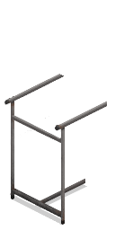 | `location_shop_generic_01_36` | Large clothing rack, east-facing (lies along the west wall) | rack | E | large_rack_e (0,1) | — | future |
| 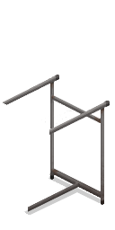 | `location_shop_generic_01_37` | Large clothing rack, east-facing (lies along the west wall) | rack | E | large_rack_e (0,0) | — | future |
| 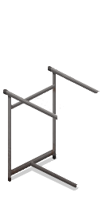 | `location_shop_generic_01_38` | Large clothing rack, south-facing (lies along the north wall) | rack | S | large_rack_s (0,0) | — | future |
| 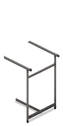 | `location_shop_generic_01_39` | Large clothing rack, south-facing (lies along the north wall) | rack | S | large_rack_s (1,0) | — | future |
| 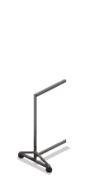 | `location_shop_generic_01_48` | Small clothing rack, east-facing (lies along the west wall) | rack | E | small_rack_e (0,1) | — | future |
| 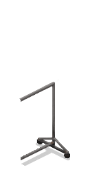 | `location_shop_generic_01_49` | Small clothing rack, east-facing (lies along the west wall) | rack | E | small_rack_e (0,0) | — | future |
| 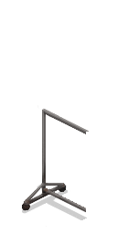 | `location_shop_generic_01_50` | Small clothing rack, south-facing (lies along the north wall) | rack | S | small_rack_s (0,0) | — | future |
| 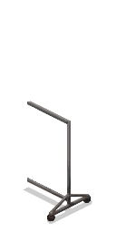 | `location_shop_generic_01_51` | Small clothing rack, south-facing (lies along the north wall) | rack | S | small_rack_s (1,0) | — | future |
| 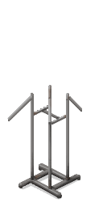 | `location_shop_generic_01_52` | Clothes stand (freestanding), no facing | rack | — | clothes_stand | — | future |
| 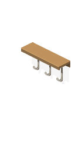 | `location_community_school_01_36` | School coat rack (hooks), south-facing (lies along the north wall) | rack | S | coat_rack | — | future |
| 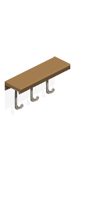 | `location_community_school_01_37` | School coat rack (hooks), east-facing (lies along the west wall) | rack | E | coat_rack | — | future |
| 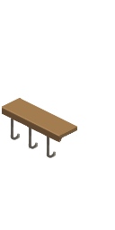 | `location_community_school_01_38` | School coat rack (hooks), north-facing (on the south edge) | rack | N | coat_rack | — | future |
| 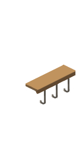 | `location_community_school_01_39` | School coat rack (hooks), west-facing (on the east edge) | rack | W | coat_rack | — | future |

Notes:
- `location_shop_generic_01_36`: Large rack (GroupName "Large Clothes"), 2 tiles per facing. E: _36 (0,1) + _37 (0,0); S: _38 (0,0) + _39 (1,0).
- `location_shop_generic_01_48`: Small rack ("Small Clothes"), same layout: E _48/_49, S _50/_51.
- `location_shop_generic_01_52`: "Clothes Stand", single tile, no `Facing` in its definition; freestanding two-arm rail.
- `location_community_school_01_36`: School coat rack, a wooden board with three hooks, one tile per facing, no `container`. Single tile, simplest first candidate.

## Clothing-rack container, shelf or wardrobe shaped (review)

| Preview | Sprite | Name | Kind | Facing | Group | Config | Role |
|---|---|---|---|---|---|---|---|
| 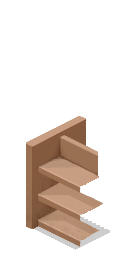 | `location_shop_generic_01_40` | Long clothing shelf, south-facing (lies along the north wall) | shelf | S | long_shelf_s (0,0) | — | candidate |
| 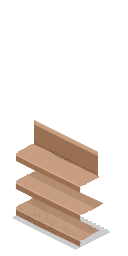 | `location_shop_generic_01_41` | Long clothing shelf, south-facing (lies along the north wall) | shelf | S | long_shelf_s (1,0) | — | candidate |
|  | `location_shop_generic_01_42` | Long clothing shelf, south-facing (lies along the north wall) | shelf | S | long_shelf_s (2,0) | — | candidate |
| 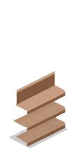 | `location_shop_generic_01_45` | Long clothing shelf, east-facing (lies along the west wall) | shelf | E | long_shelf_e (0,2) | — | candidate |
|  | `location_shop_generic_01_46` | Long clothing shelf, east-facing (lies along the west wall) | shelf | E | long_shelf_e (0,1) | — | candidate |
| 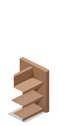 | `location_shop_generic_01_47` | Long clothing shelf, east-facing (lies along the west wall) | shelf | E | long_shelf_e (0,0) | — | candidate |
| 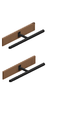 | `location_shop_generic_01_53` | Clothing shop shelf, east-facing (lies along the west wall) | shelf | E | shop_shelf | — | candidate |
| 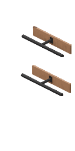 | `location_shop_generic_01_54` | Clothing shop shelf, south-facing (lies along the north wall) | shelf | S | shop_shelf | — | candidate |
| 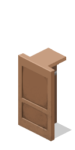 | `location_shop_generic_01_56` | Open wardrobe, east-facing (lies along the west wall) | shelf | E | open_wardrobe_e (0,2) | — | candidate |
| 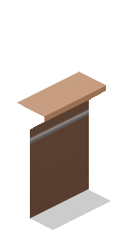 | `location_shop_generic_01_57` | Open wardrobe, east-facing (lies along the west wall) | shelf | E | open_wardrobe_e (0,1) | — | candidate |
| 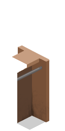 | `location_shop_generic_01_58` | Open wardrobe, east-facing (lies along the west wall) | shelf | E | open_wardrobe_e (0,0) | — | candidate |
| 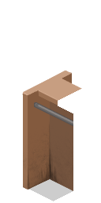 | `location_shop_generic_01_59` | Open wardrobe, south-facing (lies along the north wall) | shelf | S | open_wardrobe_s (0,0) | — | candidate |
| 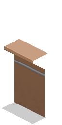 | `location_shop_generic_01_60` | Open wardrobe, south-facing (lies along the north wall) | shelf | S | open_wardrobe_s (1,0) | — | candidate |
| 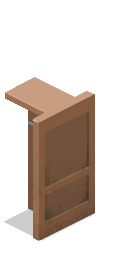 | `location_shop_generic_01_61` | Open wardrobe, south-facing (lies along the north wall) | shelf | S | open_wardrobe_s (2,0) | — | candidate |

Notes:
- `location_shop_generic_01_40`: Long shelves (3 tiles per facing: S _40 to _42, E _45 (0,2) to _47 (0,0)); `container = clothingrack` but shelf boards, not a rail. Keep only if garments are meant to hang.
- `location_shop_generic_01_53`: "Clothing Shop" shelves, one tile per facing, no grid position.
- `location_shop_generic_01_56`: Open wardrobes (3 tiles per facing); the S set shows a hanging rod. Decide per tile whether a rod is visible.

## Other racks that hold clothes (not clothing racks)

Laundry drying racks, separate sprite families. Not in scope unless wanted.

| Sprites | Description |
|---|---|
| `crafted_05_74, _75` | Drying Rack, small (S, E) |
| `crafted_05_80..87` | Drying Rack, large (4 tiles per facing) |
| `crafted_05_108..111` | Drying Rack, medium (2 tiles per facing) |
| `vegetation_drying_01_0, _1, _8, _9` | Drying Rack, small (S, E) |
| `vegetation_drying_01_16..23` | Drying Rack, large (4 tiles per facing) |
| `vegetation_drying_01_216, _217, _224, _225` | Drying Rack, simple small |
| `vegetation_drying_01_232..239` | Drying Rack, large simple |

## Examined and deliberately excluded

| Sprites | Reason |
|---|---|
| `location_shop_generic_01_8..15`, `location_shop_zippee_01_8..15` | Plain shelves (`container = shelves`), "Rack" in name only |
| `location_shop_bargNclothes_01_16..23`, `location_shop_mall_signs_01_136..143` | Shop signs |
| `appliances_laundry_01_*` | Washers, dryers, laundry bin |
| `recreational_sports_01_61` | Bowling rack |
| `location_shop_generic_01_43, _44, _55` | No clothing-rack definition found |
