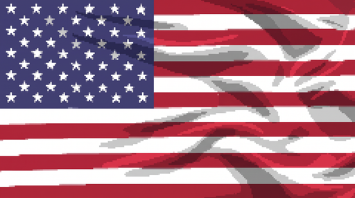

# FloppyFabrics custom textures

Textures created specifically for FloppyFabrics. Vanilla tiles are registered separately in [TILE_REGISTRY.md](TILE_REGISTRY.md).
Everything else FloppyFabrics draws is the vanilla sprite, deformed at runtime; it ships no other images.

| ID | File | Size | Format | SHA-256 | Used by | Origin |
|---|---|---|---|---|---|---|
| `pole_flag` | `mod/42/media/floppyfabrics/pole_flag.png` (runtime path `media/floppyfabrics/pole_flag.png`) | 512 × 286 px | PNG, 8-bit RGB, opaque, 137,244 bytes | `19a763d643676d220268f3d150b6cf2b46290a089c0c1163e28f0866914e1393` | `street_decoration_01_16` (American flag pole), `flags.json` → `canvas.texture`, `canvas.uv = [0,0,1,1]` | Magnific creation `YMjQSixWeC`, generated at 2752 × 1536 and downscaled (DECISIONS D91) |

Preview: 

Also listed in [TILE_REGISTRY.md](TILE_REGISTRY.md) and `registry/tiles.json` (`textures`).

## Notes
- `pole_flag`: full-bleed cloth image (no rod strip), simulated as the hanging flag canvas, size 1.6 m fly × 0.85 m hoist.
  Replaces the painted furled cloth of the vanilla pole; the pole itself is rebuilt from vanilla sprites `street_decoration_01_16` and `_24`.
- It is referenced by path at runtime (loaded through `Canvases.get`). If it cannot be loaded the pole draws as vanilla and one WARN is logged.
- It supersedes the earlier external dependency on DGVFlags' `media/dgv_flags/UnitedStates_0_0_256x143.png` (D11, dropped in D91).

## Registering a new texture
Add a row with a short ID, path, dimensions, hash (`sha256sum`), the flags.json entries that reference it, and its origin/licence.
Third-party mods that ship their own canvas PNGs register them in their own docs; FloppyFabrics only reads the path from `canvas.texture`.
