# RealFlags hanging clothes: future work

The **garments that hang on clothing racks**. They are not part of the rack sprites: the racks are drawn bare, and the clothes are separate overlay sprites (tilesets `clothing_01` and `clothing_02`, 8x8 tiles each) that the game stacks on the rack tile. **None of this is implemented.** Same layout as [TILE_REGISTRY.md](TILE_REGISTRY.md); move sprites there (with a `flags.json` / `decorations.json` entry) once done. Source: Project Zomboid 42.21.0, `media/lua/server/Items/WorldFiller.lua` (`overlayMap`, the rack tile to garment sprite mapping) and `media/tile_definitions/newtiledefinitions.tiles.txt`. Previews: `registry/previews/<sprite>.png` (PZ art, documentation only). The host rack tiles are listed in [CLOTHING_RACKS_FUTURE.md](CLOTHING_RACKS_FUTURE.md).

**How the mapping works.** Each rack tile maps to two garment sprites per set: a **dense** one and a **sparse** one (fewer garments; read from the previews). There are two sets, `clothing_01` and `clothing_02`, with the same layout but different garment colours and cuts. **Facing** is that of the host rack tile. Sprite indices that are not in this list (for example `clothing_01_46`, `_47`) are not defined in the tileset.

## Why this is manual work

One garment sprite is a single painted image of **several garments on hangers**. Before anything can be simulated, every garment must be **separated into its own cloth layer** (cut out, with its hanger point and top edge in the 128x256 frame), and only then simulated, one cloth per garment, hanging from the rail. Steps per sprite:

1. Extract the 2x frame: `python tools/flagtool.py extract <Tiles2x.pack> docs/registry/previews <sprites...>`.
2. Separate each garment into its own region/image; note the rail line and hanger point per garment.
3. Group the tiles of one rack (all share one rail) so adjacent tiles line up, like `knox_flag_s`.
4. Register via `tools/genregistry.py`; register cut-out textures in [CUSTOM_TEXTURES.md](CUSTOM_TEXTURES.md).

Dense and sparse variants hold different garments, and sets 01 and 02 differ again, so every sprite listed below is its own separation job.

## Summary

| Category | Sprites |
|---|---|
| Large clothing rack garments | 16 |
| Small clothing rack garments | 16 |
| Clothes stand garments | 4 |
| Open wardrobe garments (coats on a rod) | 24 |
| Hanging garments not referenced by any rack | 8 |

## Large clothing rack garments

Host: `location_shop_generic_01_36`..`39` (2 tiles per facing).

| Preview | Sprite | Name | Kind | Facing | Hangs on | Set | Role |
|---|---|---|---|---|---|---|---|
| 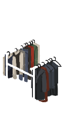 | `clothing_01_0` | Large rack clothes, dense | garments | E | `location_shop_generic_01_36` | 01 | future |
|  | `clothing_01_4` | Large rack clothes, sparse | garments | E | `location_shop_generic_01_36` | 01 | future |
|  | `clothing_02_0` | Large rack clothes, dense | garments | E | `location_shop_generic_01_36` | 02 | future |
|  | `clothing_02_4` | Large rack clothes, sparse | garments | E | `location_shop_generic_01_36` | 02 | future |
|  | `clothing_01_1` | Large rack clothes, dense | garments | E | `location_shop_generic_01_37` | 01 | future |
|  | `clothing_01_5` | Large rack clothes, sparse | garments | E | `location_shop_generic_01_37` | 01 | future |
| 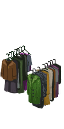 | `clothing_02_1` | Large rack clothes, dense | garments | E | `location_shop_generic_01_37` | 02 | future |
|  | `clothing_02_5` | Large rack clothes, sparse | garments | E | `location_shop_generic_01_37` | 02 | future |
|  | `clothing_01_2` | Large rack clothes, dense | garments | S | `location_shop_generic_01_38` | 01 | future |
|  | `clothing_01_6` | Large rack clothes, sparse | garments | S | `location_shop_generic_01_38` | 01 | future |
| 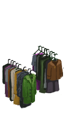 | `clothing_02_2` | Large rack clothes, dense | garments | S | `location_shop_generic_01_38` | 02 | future |
|  | `clothing_02_6` | Large rack clothes, sparse | garments | S | `location_shop_generic_01_38` | 02 | future |
|  | `clothing_01_3` | Large rack clothes, dense | garments | S | `location_shop_generic_01_39` | 01 | future |
|  | `clothing_01_7` | Large rack clothes, sparse | garments | S | `location_shop_generic_01_39` | 01 | future |
|  | `clothing_02_3` | Large rack clothes, dense | garments | S | `location_shop_generic_01_39` | 02 | future |
|  | `clothing_02_7` | Large rack clothes, sparse | garments | S | `location_shop_generic_01_39` | 02 | future |

Notes:
- `clothing_01_0`: dense set. E: `_0` on `location_shop_generic_01_36`, `_1` on `location_shop_generic_01_37`; S: `_2` on `location_shop_generic_01_38`, `_3` on `location_shop_generic_01_39`. Sparse: `_4`..`_7` in the same order.
- Both tiles of one rack are filled together; the rail runs across both.

## Small clothing rack garments

Host: `location_shop_generic_01_48`..`51` (2 tiles per facing).

| Preview | Sprite | Name | Kind | Facing | Hangs on | Set | Role |
|---|---|---|---|---|---|---|---|
|  | `clothing_01_24` | Small rack clothes, dense | garments | E | `location_shop_generic_01_48` | 01 | future |
|  | `clothing_01_28` | Small rack clothes, sparse | garments | E | `location_shop_generic_01_48` | 01 | future |
|  | `clothing_02_24` | Small rack clothes, dense | garments | E | `location_shop_generic_01_48` | 02 | future |
|  | `clothing_02_28` | Small rack clothes, sparse | garments | E | `location_shop_generic_01_48` | 02 | future |
| 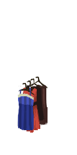 | `clothing_01_25` | Small rack clothes, dense | garments | E | `location_shop_generic_01_49` | 01 | future |
|  | `clothing_01_29` | Small rack clothes, sparse | garments | E | `location_shop_generic_01_49` | 01 | future |
|  | `clothing_02_25` | Small rack clothes, dense | garments | E | `location_shop_generic_01_49` | 02 | future |
|  | `clothing_02_29` | Small rack clothes, sparse | garments | E | `location_shop_generic_01_49` | 02 | future |
|  | `clothing_01_26` | Small rack clothes, dense | garments | S | `location_shop_generic_01_50` | 01 | future |
| 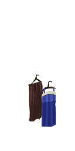 | `clothing_01_30` | Small rack clothes, sparse | garments | S | `location_shop_generic_01_50` | 01 | future |
|  | `clothing_02_26` | Small rack clothes, dense | garments | S | `location_shop_generic_01_50` | 02 | future |
|  | `clothing_02_30` | Small rack clothes, sparse | garments | S | `location_shop_generic_01_50` | 02 | future |
|  | `clothing_01_27` | Small rack clothes, dense | garments | S | `location_shop_generic_01_51` | 01 | future |
|  | `clothing_01_31` | Small rack clothes, sparse | garments | S | `location_shop_generic_01_51` | 01 | future |
|  | `clothing_02_27` | Small rack clothes, dense | garments | S | `location_shop_generic_01_51` | 02 | future |
|  | `clothing_02_31` | Small rack clothes, sparse | garments | S | `location_shop_generic_01_51` | 02 | future |

Notes:
- `clothing_01_24`: dense. E: `_24` on `location_shop_generic_01_48`, `_25` on `location_shop_generic_01_49`; S: `_26` on `location_shop_generic_01_50`, `_27` on `location_shop_generic_01_51`. Sparse: `_28`..`_31`.

## Clothes stand garments

Host: `location_shop_generic_01_52` (single tile, no facing in its definition). WorldFiller lists `_38` and `_39` as its two variants; I read them as dense/sparse from the previews.

| Preview | Sprite | Name | Kind | Facing | Hangs on | Set | Role |
|---|---|---|---|---|---|---|---|
|  | `clothing_01_38` | Clothes stand clothes, dense | garments | — | `location_shop_generic_01_52` | 01 | future |
| 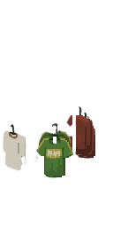 | `clothing_01_39` | Clothes stand clothes, sparse | garments | — | `location_shop_generic_01_52` | 01 | future |
|  | `clothing_02_38` | Clothes stand clothes, dense | garments | — | `location_shop_generic_01_52` | 02 | future |
|  | `clothing_02_39` | Clothes stand clothes, sparse | garments | — | `location_shop_generic_01_52` | 02 | future |

## Open wardrobe garments (coats on a rod)

Host: `location_shop_generic_01_56`..`61` (3 tiles per facing). Container type `clothingrack`; shows coats and jackets, hanging.

| Preview | Sprite | Name | Kind | Facing | Hangs on | Set | Role |
|---|---|---|---|---|---|---|---|
|  | `clothing_01_32` | Wardrobe coats, dense | garments | E | `location_shop_generic_01_56` | 01 | future |
|  | `clothing_01_40` | Wardrobe coats, sparse | garments | E | `location_shop_generic_01_56` | 01 | future |
|  | `clothing_02_32` | Wardrobe coats, dense | garments | E | `location_shop_generic_01_56` | 02 | future |
|  | `clothing_02_40` | Wardrobe coats, sparse | garments | E | `location_shop_generic_01_56` | 02 | future |
| 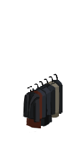 | `clothing_01_33` | Wardrobe coats, dense | garments | E | `location_shop_generic_01_57` | 01 | future |
| 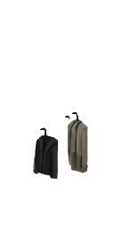 | `clothing_01_41` | Wardrobe coats, sparse | garments | E | `location_shop_generic_01_57` | 01 | future |
|  | `clothing_02_33` | Wardrobe coats, dense | garments | E | `location_shop_generic_01_57` | 02 | future |
|  | `clothing_02_41` | Wardrobe coats, sparse | garments | E | `location_shop_generic_01_57` | 02 | future |
|  | `clothing_01_34` | Wardrobe coats, dense | garments | E | `location_shop_generic_01_58` | 01 | future |
|  | `clothing_01_42` | Wardrobe coats, sparse | garments | E | `location_shop_generic_01_58` | 01 | future |
|  | `clothing_02_34` | Wardrobe coats, dense | garments | E | `location_shop_generic_01_58` | 02 | future |
|  | `clothing_02_42` | Wardrobe coats, sparse | garments | E | `location_shop_generic_01_58` | 02 | future |
|  | `clothing_01_35` | Wardrobe coats, dense | garments | S | `location_shop_generic_01_59` | 01 | future |
|  | `clothing_01_43` | Wardrobe coats, sparse | garments | S | `location_shop_generic_01_59` | 01 | future |
|  | `clothing_02_35` | Wardrobe coats, dense | garments | S | `location_shop_generic_01_59` | 02 | future |
|  | `clothing_02_43` | Wardrobe coats, sparse | garments | S | `location_shop_generic_01_59` | 02 | future |
|  | `clothing_01_36` | Wardrobe coats, dense | garments | S | `location_shop_generic_01_60` | 01 | future |
|  | `clothing_01_44` | Wardrobe coats, sparse | garments | S | `location_shop_generic_01_60` | 01 | future |
|  | `clothing_02_36` | Wardrobe coats, dense | garments | S | `location_shop_generic_01_60` | 02 | future |
|  | `clothing_02_44` | Wardrobe coats, sparse | garments | S | `location_shop_generic_01_60` | 02 | future |
|  | `clothing_01_37` | Wardrobe coats, dense | garments | S | `location_shop_generic_01_61` | 01 | future |
|  | `clothing_01_45` | Wardrobe coats, sparse | garments | S | `location_shop_generic_01_61` | 01 | future |
|  | `clothing_02_37` | Wardrobe coats, dense | garments | S | `location_shop_generic_01_61` | 02 | future |
|  | `clothing_02_45` | Wardrobe coats, sparse | garments | S | `location_shop_generic_01_61` | 02 | future |

Notes:
- `clothing_01_32`: dense. E: `_32` on `location_shop_generic_01_56`, `_33` on `location_shop_generic_01_57`, `_34` on `location_shop_generic_01_58`; S: `_35`..`_37` on `location_shop_generic_01_59`..`61`. Sparse: `_40`..`_45`.

## Hanging garments not referenced by any rack

Two-tier hanging garment groups that WorldFiller does not assign to any tile. Not in the game's rack mapping; may be unused, or used by a mod or map. Verify before spending effort.

| Preview | Sprite | Name | Kind | Facing | Hangs on | Set | Role |
|---|---|---|---|---|---|---|---|
|  | `clothing_01_14` | Hanging clothes, two tiers (unassigned) | garments | — | — | 01 | unassigned |
|  | `clothing_01_15` | Hanging clothes, two tiers (unassigned) | garments | — | — | 01 | unassigned |
|  | `clothing_01_22` | Hanging clothes, two tiers (unassigned) | garments | — | — | 01 | unassigned |
| 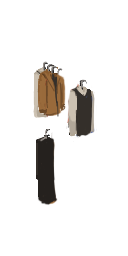 | `clothing_01_23` | Hanging clothes, two tiers (unassigned) | garments | — | — | 01 | unassigned |
| 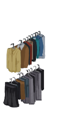 | `clothing_02_14` | Hanging clothes, two tiers (unassigned) | garments | — | — | 02 | unassigned |
| 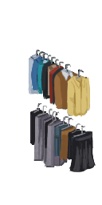 | `clothing_02_15` | Hanging clothes, two tiers (unassigned) | garments | — | — | 02 | unassigned |
| 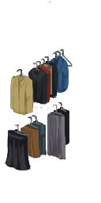 | `clothing_02_22` | Hanging clothes, two tiers (unassigned) | garments | — | — | 02 | unassigned |
| 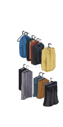 | `clothing_02_23` | Hanging clothes, two tiers (unassigned) | garments | — | — | 02 | unassigned |

## Examined and deliberately excluded

Garment sprites that do not hang from a rail.

| Sprites | Reason |
|---|---|
| `clothing_01_8..13`, `_16..21` (and `clothing_02_*`) | Folded clothes on shelves (hosts `location_shop_generic_01_40`..`42`, `45`..`47`) |
| `clothing_01_48..55`, `clothing_02_48..52` | Shoes and stacked clothes on shelves (hosts `location_shop_generic_01_62`, `63`, `86`, `87`, shelves) |
