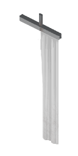
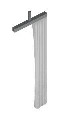
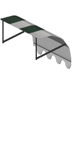
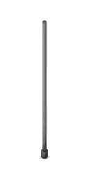

# RealFlags tile registry

Every tile RealFlags reads or animates, with its exact sprite name. Machine-readable twin: [`registry/tiles.json`](registry/tiles.json). Custom textures are registered separately in [CUSTOM_TEXTURES.md](CUSTOM_TEXTURES.md).

Regenerate with `python tools/genregistry.py` (sprite lists come from `flags.json` / `decorations.json`; names are curated in the script).

**Names** are descriptive labels derived from the tile family, `facing`, and the evidence in `DECISIONS.md`; they are not vanilla display names. **Facing:** S lies along the north wall, E along the west wall, N/W on the south/east edge.

## Sources

| Source id | Name | Version | Kind |
|---|---|---|---|
| `vanilla` | Project Zomboid | 42.21.0 | vanilla |
| `realflags` | Real Flags (custom textures) | 0.6.0 | mod |

### Adding a third-party mod

1. Add a row to `sources` (`id` = the mod's id, name, version, `kind: "mod"`).
2. Add its tiles to `tiles` with `"source": "<id>"`; keep the sprite name exact.
3. The mod itself ships `media/realflags/*.json` (see [FLAGS_JSON.md](FLAGS_JSON.md)); registry entries should name that file in `config`.

Sprite names are globally unique, so `source` is informational, not a namespace.

Previews (`registry/previews/<sprite>.png`, full 128x256 2x tile frames) are extracted from the game's `Tiles2x.pack` with `python tools/flagtool.py extract <Tiles2x.pack> docs/registry/previews <sprites...>`. They are Project Zomboid art (c) The Indie Stone, included for documentation only; delete the folder to drop them (the table falls back to a dash).

## Summary

172 sprites registered (170 configured entries, 2 reference/host tiles) plus pattern-based entries.

| Category | Sprites |
|---|---|
| banner | 24 |
| canopy | 84 |
| curtain | 18 |
| drape | 4 |
| pole flag | 1 |
| string line | 28 |
| wall flag | 11 |

## Banner

| Preview | Sprite | Name | Kind | Facing | Group | Config | Role |
|---|---|---|---|---|---|---|---|
|  | `lighting_outdoor_01_4` | Street light pole, bare (host of Riverside pole banner) | — | — | — | flags.json | host |
|  | `location_community_church_small_01_76` | Church banner, south-facing (lies along the north wall) | wall | S | — | flags.json | primary |
|  | `location_community_church_small_01_77` | Church banner, south-facing (lies along the north wall) | wall | S | — | flags.json | primary |
|  | `location_community_church_small_01_78` | Church banner, south-facing (lies along the north wall) | wall | S | — | flags.json | primary |
|  | `location_community_church_small_01_84` | Church banner, east-facing (lies along the west wall) | wall | E | — | flags.json | primary |
|  | `location_community_church_small_01_85` | Church banner, east-facing (lies along the west wall) | wall | E | — | flags.json | primary |
|  | `location_community_church_small_01_86` | Church banner, east-facing (lies along the west wall) | wall | E | — | flags.json | primary |
|  | `signs_one-off_09_312` | Riverside street banner segment 1/16, east-facing (lies along the west wall) | wall | E | riverside_banner | flags.json | primary |
|  | `signs_one-off_09_313` | Riverside street banner segment 2/16, east-facing (lies along the west wall) | wall | E | riverside_banner | flags.json | primary |
|  | `signs_one-off_09_314` | Riverside street banner segment 3/16, east-facing (lies along the west wall) | wall | E | riverside_banner | flags.json | primary |
|  | `signs_one-off_09_315` | Riverside street banner segment 4/16, east-facing (lies along the west wall) | wall | E | riverside_banner | flags.json | primary |
|  | `signs_one-off_09_316` | Riverside street banner segment 5/16, east-facing (lies along the west wall) | wall | E | riverside_banner | flags.json | primary |
|  | `signs_one-off_09_317` | Riverside street banner segment 6/16, east-facing (lies along the west wall) | wall | E | riverside_banner | flags.json | primary |
|  | `signs_one-off_09_318` | Riverside street banner segment 7/16, east-facing (lies along the west wall) | wall | E | riverside_banner | flags.json | primary |
|  | `signs_one-off_09_319` | Riverside street banner segment 8/16, east-facing (lies along the west wall) | wall | E | riverside_banner | flags.json | primary |
|  | `signs_one-off_09_320` | Riverside street banner segment 9/16, east-facing (lies along the west wall) | wall | E | riverside_banner | flags.json | primary |
|  | `signs_one-off_09_321` | Riverside street banner segment 10/16, east-facing (lies along the west wall) | wall | E | riverside_banner | flags.json | primary |
|  | `signs_one-off_09_322` | Riverside street banner segment 11/16, east-facing (lies along the west wall) | wall | E | riverside_banner | flags.json | primary |
|  | `signs_one-off_09_323` | Riverside street banner segment 12/16, east-facing (lies along the west wall) | wall | E | riverside_banner | flags.json | primary |
|  | `signs_one-off_09_324` | Riverside street banner segment 13/16, east-facing (lies along the west wall) | wall | E | riverside_banner | flags.json | primary |
|  | `signs_one-off_09_325` | Riverside street banner segment 14/16, east-facing (lies along the west wall) | wall | E | riverside_banner | flags.json | primary |
|  | `signs_one-off_09_326` | Riverside street banner segment 15/16, east-facing (lies along the west wall) | wall | E | riverside_banner | flags.json | primary |
|  | `signs_one-off_09_327` | Riverside street banner segment 16/16, east-facing (lies along the west wall) | wall | E | riverside_banner | flags.json | primary |
|  | `signs_one-off_09_336` | Riverside pole banner on light pole, east-facing (lies along the west wall) | wall | E | — | flags.json | primary |
|  | `signs_one-off_09_337` | Riverside pole banner on light pole, east-facing (lies along the west wall) | wall | E | — | flags.json | primary |

Notes:
- `lighting_outdoor_01_4`: signs_one-off_09_336/337 hang from it, as own object or as attached sprite of this pole (D90).
- `location_community_church_small_01_76`: Church banners (attachedN/W). Where the art runs a few px below the floor line, h stops at the floor.
- `signs_one-off_09_312`: Riverside street banner: 16 tiles running north from _312 (each the next square north), hung from a sagging cable and lashed to a pole at each end (D87). One cloth; topCurve is its cable in the _312 frame.
- `signs_one-off_09_336`: Riverside pole banner on a street light pole (lighting_outdoor_01_4): hangs from its top arm, tied down at its lower corners (D90). Works as its own object or as an attached sprite of the pole.

## Drape

| Preview | Sprite | Name | Kind | Facing | Group | Config | Role |
|---|---|---|---|---|---|---|---|
|  | `location_community_church_small_01_40` | Church altar cloth, east-facing (lies along the west wall) | drape | E | — | decorations.json | primary |
|  | `location_community_church_small_01_41` | Church altar cloth, east-facing (lies along the west wall) | drape | E | — | decorations.json | primary |
|  | `location_community_church_small_01_42` | Church altar cloth, south-facing (lies along the north wall) | drape | S | — | decorations.json | primary |
|  | `location_community_church_small_01_43` | Church altar cloth, south-facing (lies along the north wall) | drape | S | — | decorations.json | primary |

Notes:
- `location_community_church_small_01_40`: Altar cloth hanging down the altar face; only the cloth columns move (D82).

## Curtain

| Preview | Sprite | Name | Kind | Facing | Group | Config | Role |
|---|---|---|---|---|---|---|---|
|  | `location_community_medical_01_41` | Hospital privacy curtain (blue), south-facing (lies along the north wall) | wall | S | — | flags.json | primary |
|  | `location_community_medical_01_42` | Hospital privacy curtain (blue), south-facing (lies along the north wall) | wall | S | — | flags.json | primary |
|  | `location_community_medical_01_43` | Hospital privacy curtain (blue), south-facing (lies along the north wall) | wall | S | — | flags.json | primary |
|  | `location_community_medical_01_45` | Hospital privacy curtain (blue), east-facing (lies along the west wall) | wall | E | — | flags.json | primary |
|  | `location_community_medical_01_46` | Hospital privacy curtain (blue), east-facing (lies along the west wall) | wall | E | — | flags.json | primary |
|  | `location_community_medical_01_47` | Hospital privacy curtain (blue), east-facing (lies along the west wall) | wall | E | — | flags.json | primary |
|  | `location_community_medical_01_144` | Hospital privacy curtain (white), south-facing (lies along the north wall) | wall | S | — | flags.json | primary |
|  | `location_community_medical_01_145` | Hospital privacy curtain (white), south-facing (lies along the north wall) | wall | S | — | flags.json | primary |
|  | `location_community_medical_01_146` | Hospital privacy curtain (white), south-facing (lies along the north wall) | wall | S | — | flags.json | primary |
|  | `location_community_medical_01_147` | Hospital privacy curtain (white), east-facing (lies along the west wall) | wall | E | — | flags.json | primary |
|  | `location_community_medical_01_148` | Hospital privacy curtain (white), east-facing (lies along the west wall) | wall | E | — | flags.json | primary |
|  | `location_community_medical_01_149` | Hospital privacy curtain (white), east-facing (lies along the west wall) | wall | E | — | flags.json | primary |
|  | `location_entertainment_theatre_01_92` | Theatre stage curtain, south-facing (lies along the north wall) | wall | S | — | flags.json | primary |
|  | `location_entertainment_theatre_01_93` | Theatre stage curtain, south-facing (lies along the north wall) | wall | S | — | flags.json | primary |
|  | `location_entertainment_theatre_01_94` | Theatre stage curtain, south-facing (lies along the north wall) | wall | S | — | flags.json | primary |
|  | `location_entertainment_theatre_01_101` | Theatre stage curtain, east-facing (lies along the west wall) | wall | E | — | flags.json | primary |
|  | `location_entertainment_theatre_01_102` | Theatre stage curtain, east-facing (lies along the west wall) | wall | E | — | flags.json | primary |
|  | `location_entertainment_theatre_01_103` | Theatre stage curtain, east-facing (lies along the west wall) | wall | E | — | flags.json | primary |

Notes:
- `location_community_medical_01_41`: Hospital privacy curtains (blue 41-47; white 144-149 have the same shapes) hang from a rail across the middle of their square: inset 0.5. The cloth starts under the rail, so the rail stays still. Rails 40/44 have no cloth.
- `location_entertainment_theatre_01_92`: Theatre stage curtains: same rail geometry as the hospital curtains (inset 0.5). Rods 95/100 have no cloth.

## Wall flag

| Preview | Sprite | Name | Kind | Facing | Group | Config | Role |
|---|---|---|---|---|---|---|---|
|  | `location_military_knox_01_8` | Fort Knox flag, 3-tile cloth, south-facing (lies along the north wall) | wall | S | knox_flag_s | flags.json | primary |
|  | `location_military_knox_01_9` | Fort Knox flag, 3-tile cloth, south-facing (lies along the north wall) | wall | S | knox_flag_s | flags.json | primary |
|  | `location_military_knox_01_10` | Fort Knox flag, 3-tile cloth, south-facing (lies along the north wall) | wall | S | knox_flag_s | flags.json | primary |
|  | `location_military_knox_01_11` | Fort Knox flag, 3-tile cloth, east-facing (lies along the west wall) | wall | E | knox_flag_e | flags.json | primary |
|  | `location_military_knox_01_12` | Fort Knox flag, 3-tile cloth, east-facing (lies along the west wall) | wall | E | knox_flag_e | flags.json | primary |
|  | `location_military_knox_01_13` | Fort Knox flag, 3-tile cloth, east-facing (lies along the west wall) | wall | E | knox_flag_e | flags.json | primary |
|  | `location_restaurant_bar_smutz_23` | White wall banner, south-facing (lies along the north wall) | wall | S | — | flags.json | primary |
|  | `walls_decoration_01_16` | Wall-mounted flag, south-facing (lies along the north wall) | wall | S | — | flags.json | primary |
|  | `walls_decoration_01_17` | Wall-mounted flag, east-facing (lies along the west wall) | wall | E | — | flags.json | primary |
|  | `walls_decoration_01_18` | Wall-mounted flag, south-facing (lies along the north wall) | wall | S | — | flags.json | primary |
|  | `walls_decoration_01_19` | Wall-mounted flag, east-facing (lies along the west wall) | wall | E | — | flags.json | primary |

Notes:
- `location_military_knox_01_8`: Fort Knox flag over 3 tiles (SpriteGridPos 0..2,0): one cloth shared by its tiles (D87). Cloth in the anchor tile _8 frame.
- `location_military_knox_01_13`: Fort Knox flag along the west wall: anchor _13 (0,0), _12 (0,1), _11 (0,2).
- `location_restaurant_bar_smutz_23`: White banner (Tiles2x only), WallOverlay like walls_decoration_01_16.

## Canopy

| Preview | Sprite | Name | Kind | Facing | Group | Config | Role |
|---|---|---|---|---|---|---|---|
|  | `location_restaurant_bar_smutz_12` | Sloped wall awning, south-facing (lies along the north wall) | canopy | S | — | decorations.json | primary |
|  | `location_restaurant_bar_smutz_13` | Sloped wall awning, east-facing (lies along the west wall) | canopy | E | — | decorations.json | primary |
|  | `location_restaurant_bar_smutz_14` | Sloped wall awning, east-facing (lies along the west wall) | canopy | E | — | decorations.json | primary |
|  | `location_restaurant_bar_smutz_15` | Sloped wall awning, east-facing (lies along the west wall) | canopy | E | — | decorations.json | primary |
|  | `location_restaurant_pie_01_4` | Sloped wall awning, south-facing (lies along the north wall) | canopy | S | — | decorations.json | primary |
|  | `location_restaurant_pie_01_5` | Sloped wall awning, east-facing (lies along the west wall) | canopy | E | — | decorations.json | primary |
|  | `location_restaurant_pileocrepe_01_4` | Sloped wall awning, south-facing (lies along the north wall) | canopy | S | — | decorations.json | primary |
|  | `location_restaurant_pileocrepe_01_5` | Sloped wall awning, east-facing (lies along the west wall) | canopy | E | — | decorations.json | primary |
|  | `walls_decoration_01_68` | Sloped wall awning, south-facing (lies along the north wall) | canopy | S | — | decorations.json | primary |
|  | `walls_decoration_01_69` | Sloped wall awning, east-facing (lies along the west wall) | canopy | E | — | decorations.json | primary |
|  | `walls_decoration_01_70` | Sloped wall awning, south-facing (lies along the north wall) | canopy | S | — | decorations.json | primary |
|  | `walls_decoration_01_71` | Sloped wall awning, east-facing (lies along the west wall) | canopy | E | — | decorations.json | primary |
|  | `walls_decoration_01_84` | Flat awning, south-facing (lies along the north wall) | canopy | S | — | decorations.json | primary |
|  | `walls_decoration_01_85` | Flat awning, east-facing (lies along the west wall) | canopy | E | — | decorations.json | primary |
|  | `walls_decoration_01_86` | Conical awning, south-facing (lies along the north wall) | canopy | S | — | decorations.json | primary |
|  | `walls_decoration_01_87` | Quarter-round awning, west-facing (on the east edge) | canopy | W | — | decorations.json | primary |
|  | `walls_decoration_01_92` | Awning, back view, north-facing (on the south edge) | canopy | N | — | decorations.json | primary |
|  | `walls_decoration_01_93` | Awning, back view, west-facing (on the east edge) | canopy | W | — | decorations.json | primary |
|  | `walls_decoration_01_94` | Quarter-round awning, east-facing (lies along the west wall) | canopy | E | — | decorations.json | primary |
|  | `walls_decoration_01_95` | Curved awning, back view, north-facing (on the south edge) | canopy | N | — | decorations.json | primary |
|  | `walls_decoration_01_100` | Flat awning, south-facing (lies along the north wall) | canopy | S | — | decorations.json | primary |
|  | `walls_decoration_01_101` | Flat awning, east-facing (lies along the west wall) | canopy | E | — | decorations.json | primary |
|  | `walls_decoration_01_102` | Conical awning, south-facing (lies along the north wall) | canopy | S | — | decorations.json | primary |
|  | `walls_decoration_01_103` | Quarter-round awning, west-facing (on the east edge) | canopy | W | — | decorations.json | primary |
|  | `walls_decoration_01_108` | Awning, back view, north-facing (on the south edge) | canopy | N | — | decorations.json | primary |
|  | `walls_decoration_01_109` | Awning, back view, west-facing (on the east edge) | canopy | W | — | decorations.json | primary |
|  | `walls_decoration_01_110` | Quarter-round awning, east-facing (lies along the west wall) | canopy | E | — | decorations.json | primary |
|  | `walls_decoration_01_111` | Curved awning, back view, north-facing (on the south edge) | canopy | N | — | decorations.json | primary |
|  | `walls_decoration_01_112` | Sloped wall awning, south-facing (lies along the north wall) | canopy | S | — | decorations.json | primary |
|  | `walls_decoration_01_113` | Sloped wall awning, east-facing (lies along the west wall) | canopy | E | — | decorations.json | primary |
|  | `walls_decoration_01_114` | Sloped wall awning, south-facing (lies along the north wall) | canopy | S | — | decorations.json | primary |
|  | `walls_decoration_01_115` | Sloped wall awning, east-facing (lies along the west wall) | canopy | E | — | decorations.json | primary |
|  | `walls_decoration_01_116` | Flat awning, south-facing (lies along the north wall) | canopy | S | — | decorations.json | primary |
|  | `walls_decoration_01_117` | Flat awning, east-facing (lies along the west wall) | canopy | E | — | decorations.json | primary |
|  | `walls_decoration_01_118` | Conical awning, south-facing (lies along the north wall) | canopy | S | — | decorations.json | primary |
|  | `walls_decoration_01_119` | Quarter-round awning, west-facing (on the east edge) | canopy | W | — | decorations.json | primary |
|  | `walls_decoration_01_120` | Sloped wall awning, south-facing (lies along the north wall) | canopy | S | — | decorations.json | primary |
|  | `walls_decoration_01_121` | Sloped wall awning, east-facing (lies along the west wall) | canopy | E | — | decorations.json | primary |
|  | `walls_decoration_01_122` | Sloped wall awning, south-facing (lies along the north wall) | canopy | S | — | decorations.json | primary |
|  | `walls_decoration_01_123` | Sloped wall awning, east-facing (lies along the west wall) | canopy | E | — | decorations.json | primary |
|  | `walls_decoration_01_124` | Awning, back view, north-facing (on the south edge) | canopy | N | — | decorations.json | primary |
|  | `walls_decoration_01_125` | Awning, back view, west-facing (on the east edge) | canopy | W | — | decorations.json | primary |
|  | `walls_decoration_01_126` | Quarter-round awning, east-facing (lies along the west wall) | canopy | E | — | decorations.json | primary |
|  | `walls_decoration_01_127` | Curved awning, back view, north-facing (on the south edge) | canopy | N | — | decorations.json | primary |
|  | `walls_decoration_01_128` | Flat awning, south-facing (lies along the north wall) | canopy | S | — | decorations.json | primary |
|  | `walls_decoration_01_129` | Flat awning, east-facing (lies along the west wall) | canopy | E | — | decorations.json | primary |
|  | `walls_decoration_01_130` | Conical awning, south-facing (lies along the north wall) | canopy | S | — | decorations.json | primary |
|  | `walls_decoration_01_131` | Quarter-round awning, west-facing (on the east edge) | canopy | W | — | decorations.json | primary |
|  | `walls_decoration_01_132` | Flat awning, south-facing (lies along the north wall) | canopy | S | — | decorations.json | primary |
|  | `walls_decoration_01_133` | Flat awning, east-facing (lies along the west wall) | canopy | E | — | decorations.json | primary |
|  | `walls_decoration_01_134` | Conical awning, south-facing (lies along the north wall) | canopy | S | — | decorations.json | primary |
|  | `walls_decoration_01_135` | Quarter-round awning, west-facing (on the east edge) | canopy | W | — | decorations.json | primary |
|  | `walls_decoration_01_136` | Awning, back view, north-facing (on the south edge) | canopy | N | — | decorations.json | primary |
|  | `walls_decoration_01_137` | Awning, back view, west-facing (on the east edge) | canopy | W | — | decorations.json | primary |
|  | `walls_decoration_01_138` | Quarter-round awning, east-facing (lies along the west wall) | canopy | E | — | decorations.json | primary |
|  | `walls_decoration_01_139` | Curved awning, back view, north-facing (on the south edge) | canopy | N | — | decorations.json | primary |
|  | `walls_decoration_01_140` | Awning, back view, north-facing (on the south edge) | canopy | N | — | decorations.json | primary |
|  | `walls_decoration_01_141` | Awning, back view, west-facing (on the east edge) | canopy | W | — | decorations.json | primary |
|  | `walls_decoration_01_142` | Quarter-round awning, east-facing (lies along the west wall) | canopy | E | — | decorations.json | primary |
|  | `walls_decoration_01_143` | Curved awning, back view, north-facing (on the south edge) | canopy | N | — | decorations.json | primary |
|  | `walls_decoration_01_144` | Arched awning, south-facing (lies along the north wall) | canopy | S | — | decorations.json | primary |
|  | `walls_decoration_01_145` | Arched awning, east-facing (lies along the west wall) | canopy | E | — | decorations.json | primary |
|  | `walls_decoration_01_146` | Conical awning, south-facing (lies along the north wall) | canopy | S | — | decorations.json | primary |
|  | `walls_decoration_01_147` | Quarter-round awning, east-facing (lies along the west wall) | canopy | E | — | decorations.json | primary |
|  | `walls_decoration_01_148` | Arched awning, back view, west-facing (on the east edge) | canopy | W | — | decorations.json | primary |
|  | `walls_decoration_01_149` | Arched awning, back view, north-facing (on the south edge) | canopy | N | — | decorations.json | primary |
|  | `walls_decoration_01_150` | Quarter-round awning, west-facing (on the east edge) | canopy | W | — | decorations.json | primary |
|  | `walls_decoration_01_151` | Dome awning, back view, north-facing (on the south edge) | canopy | N | — | decorations.json | primary |
|  | `walls_decoration_01_152` | Arched awning, south-facing (lies along the north wall) | canopy | S | — | decorations.json | primary |
|  | `walls_decoration_01_153` | Arched awning, east-facing (lies along the west wall) | canopy | E | — | decorations.json | primary |
|  | `walls_decoration_01_154` | Conical awning, south-facing (lies along the north wall) | canopy | S | — | decorations.json | primary |
|  | `walls_decoration_01_155` | Quarter-round awning, east-facing (lies along the west wall) | canopy | E | — | decorations.json | primary |
|  | `walls_decoration_01_156` | Arched awning, back view, west-facing (on the east edge) | canopy | W | — | decorations.json | primary |
|  | `walls_decoration_01_157` | Arched awning, back view, north-facing (on the south edge) | canopy | N | — | decorations.json | primary |
|  | `walls_decoration_01_158` | Quarter-round awning, west-facing (on the east edge) | canopy | W | — | decorations.json | primary |
|  | `walls_decoration_01_159` | Dome awning, back view, north-facing (on the south edge) | canopy | N | — | decorations.json | primary |
|  | `walls_decoration_01_160` | Arched awning, south-facing (lies along the north wall) | canopy | S | — | decorations.json | primary |
|  | `walls_decoration_01_161` | Arched awning, east-facing (lies along the west wall) | canopy | E | — | decorations.json | primary |
|  | `walls_decoration_01_162` | Conical awning, south-facing (lies along the north wall) | canopy | S | — | decorations.json | primary |
|  | `walls_decoration_01_163` | Quarter-round awning, east-facing (lies along the west wall) | canopy | E | — | decorations.json | primary |
|  | `walls_decoration_01_164` | Arched awning, back view, west-facing (on the east edge) | canopy | W | — | decorations.json | primary |
|  | `walls_decoration_01_165` | Arched awning, back view, north-facing (on the south edge) | canopy | N | — | decorations.json | primary |
|  | `walls_decoration_01_166` | Quarter-round awning, west-facing (on the east edge) | canopy | W | — | decorations.json | primary |
|  | `walls_decoration_01_167` | Dome awning, back view, north-facing (on the south edge) | canopy | N | — | decorations.json | primary |

## String line

| Preview | Sprite | Name | Kind | Facing | Group | Config | Role |
|---|---|---|---|---|---|---|---|
|  | `location_restaurant_bar_smutz_32` | Bunting, tile of a 2-tile string, south (runs east) | line | — | — | decorations.json | primary |
|  | `location_restaurant_bar_smutz_33` | Bunting, tile of a 2-tile string, south (runs east) | line | — | — | decorations.json | primary |
|  | `location_restaurant_bar_smutz_34` | Bunting, tile of a 2-tile string, east (runs south) | line | — | — | decorations.json | primary |
|  | `location_restaurant_bar_smutz_35` | Bunting, tile of a 2-tile string, east (runs south) | line | — | — | decorations.json | primary |
|  | `walls_decoration_01_64` | Bunting, tile of a 2-tile string, south (runs east) | line | — | — | decorations.json | primary |
|  | `walls_decoration_01_65` | Bunting, tile of a 2-tile string, south (runs east) | line | — | — | decorations.json | primary |
|  | `walls_decoration_01_66` | Bunting, tile of a 2-tile string, east (runs south) | line | — | — | decorations.json | primary |
|  | `walls_decoration_01_67` | Bunting, tile of a 2-tile string, east (runs south) | line | — | — | decorations.json | primary |
|  | `walls_decoration_01_72` | Bunting, tile of a 2-tile string, south (runs east) | line | — | — | decorations.json | primary |
|  | `walls_decoration_01_73` | Bunting, tile of a 2-tile string, south (runs east) | line | — | — | decorations.json | primary |
|  | `walls_decoration_01_74` | Bunting, tile of a 2-tile string, east (runs south) | line | — | — | decorations.json | primary |
|  | `walls_decoration_01_75` | Bunting, tile of a 2-tile string, east (runs south) | line | — | — | decorations.json | primary |
|  | `walls_decoration_01_76` | Rainbow string lights, tile of a 2-tile string, south (runs east) | line | — | — | decorations.json | primary |
|  | `walls_decoration_01_77` | Rainbow string lights, tile of a 2-tile string, south (runs east) | line | — | — | decorations.json | primary |
|  | `walls_decoration_01_78` | Rainbow string lights, tile of a 2-tile string, east (runs south) | line | — | — | decorations.json | primary |
|  | `walls_decoration_01_79` | Rainbow string lights, tile of a 2-tile string, east (runs south) | line | — | — | decorations.json | primary |
|  | `walls_decoration_01_80` | Bunting, tile of a 2-tile string, south (runs east) | line | — | — | decorations.json | primary |
|  | `walls_decoration_01_81` | Bunting, tile of a 2-tile string, south (runs east) | line | — | — | decorations.json | primary |
|  | `walls_decoration_01_82` | Bunting, tile of a 2-tile string, east (runs south) | line | — | — | decorations.json | primary |
|  | `walls_decoration_01_83` | Bunting, tile of a 2-tile string, east (runs south) | line | — | — | decorations.json | primary |
|  | `walls_decoration_01_88` | Small fairy string lights, tile of a 2-tile string, south (runs east) | line | — | — | decorations.json | primary |
|  | `walls_decoration_01_89` | Small fairy string lights, tile of a 2-tile string, south (runs east) | line | — | — | decorations.json | primary |
|  | `walls_decoration_01_90` | Small fairy string lights, tile of a 2-tile string, east (runs south) | line | — | — | decorations.json | primary |
|  | `walls_decoration_01_91` | Small fairy string lights, tile of a 2-tile string, east (runs south) | line | — | — | decorations.json | primary |
|  | `walls_decoration_01_96` | Large bulb string lights, tile of a 2-tile string, south (runs east) | line | — | — | decorations.json | primary |
|  | `walls_decoration_01_97` | Large bulb string lights, tile of a 2-tile string, south (runs east) | line | — | — | decorations.json | primary |
|  | `walls_decoration_01_98` | Large bulb string lights, tile of a 2-tile string, east (runs south) | line | — | — | decorations.json | primary |
|  | `walls_decoration_01_99` | Large bulb string lights, tile of a 2-tile string, east (runs south) | line | — | — | decorations.json | primary |

Notes:
- `location_restaurant_bar_smutz_32`: S string over two tiles: this tile and the next east
- `location_restaurant_bar_smutz_35`: E string over two tiles: this tile and the next south
- `walls_decoration_01_64`: S string over two tiles: this tile and the next east
- `walls_decoration_01_67`: E string over two tiles: this tile and the next south
- `walls_decoration_01_72`: S string over two tiles: this tile and the next east
- `walls_decoration_01_75`: E string over two tiles: this tile and the next south
- `walls_decoration_01_76`: S string over two tiles: this tile and the next east Lit variant: walls_decoration_01_on_76 (derived).
- `walls_decoration_01_77`: Lit variant: walls_decoration_01_on_77 (derived).
- `walls_decoration_01_78`: Lit variant: walls_decoration_01_on_78 (derived).
- `walls_decoration_01_79`: E string over two tiles: this tile and the next south Lit variant: walls_decoration_01_on_79 (derived).
- `walls_decoration_01_80`: S string over two tiles: this tile and the next east
- `walls_decoration_01_83`: E string over two tiles: this tile and the next south
- `walls_decoration_01_88`: S string over two tiles: this tile and the next east Lit variant: walls_decoration_01_on_88 (derived).
- `walls_decoration_01_89`: Lit variant: walls_decoration_01_on_89 (derived).
- `walls_decoration_01_90`: Lit variant: walls_decoration_01_on_90 (derived).
- `walls_decoration_01_91`: E string over two tiles: this tile and the next south Lit variant: walls_decoration_01_on_91 (derived).
- `walls_decoration_01_96`: S string over two tiles: this tile and the next east Lit variant: walls_decoration_01_on_96 (derived).
- `walls_decoration_01_97`: Lit variant: walls_decoration_01_on_97 (derived).
- `walls_decoration_01_98`: Lit variant: walls_decoration_01_on_98 (derived).
- `walls_decoration_01_99`: E string over two tiles: this tile and the next south Lit variant: walls_decoration_01_on_99 (derived).

## Pole flag

| Preview | Sprite | Name | Kind | Facing | Group | Config | Role |
|---|---|---|---|---|---|---|---|
|  | `street_decoration_01_16` | American flag pole, upper tile (replaced furled cloth) | pole | — | — | flags.json | primary |
|  | `street_decoration_01_24` | American flag pole, lower tile (shaft source) | — | — | — | flags.json | reference |

Notes:
- `street_decoration_01_16`: Upper tile of the vanilla American Flag pole. The painted furled cloth is replaced by a canvas shipped with this mod (media/realflags/pole_flag.png); the pole is rebuilt from the finial of this sprite and a clean shaft slice of the lower tile street_decoration_01_24.
- `street_decoration_01_24`: Clean shaft slice (src 60,100-68,164) copied by flags.json staticQuads onto the upper tile.

## Custom textures (created for RealFlags)

Details and notes: [CUSTOM_TEXTURES.md](CUSTOM_TEXTURES.md).

| Preview | ID | File | Size | Used by | Config | Origin |
|---|---|---|---|---|---|---|
|  | `pole_flag` | `mod/42/media/realflags/pole_flag.png` | 512x286 | `street_decoration_01_16` | flags.json canvas.texture, uv [0,0,1,1] | Magnific creation YMjQSixWeC, downscaled from 2752x1536 (D91) |

## Pattern-based entries (no per-sprite JSON entry)

| Pattern | Name | Config | Notes |
|---|---|---|---|
| `fixtures_windows_curtains_01_*, fixtures_windows_curtains_02_*` | Vanilla window curtains (144 tiles; each row of 8 = closed W/E/N/S then open) | auto (curtainN/S/W/E tile type, DECISIONS D63/D64) | No JSON entry; geometry measured at runtime. Any mod's sprite with a curtain tile type works the same. |
| `fixtures_windows_curtains_01_16..23` | Player-hung sheets (closed 16..19, rolled 20..23) | auto (D72) | 3D sprite models; swapped to the 2D sprite while the window is open/broken. |
| `<tileset>_on_<n>` | Lit overlay of a string-light tile | derived (D84) | Vanilla's lit-overlay naming; mapped to the base sprite's definition by FlagRegistry.onSpriteName. |

## Examined and deliberately excluded

| Sprites | Reason |
|---|---|
| `location_community_medical_01_40, _44` | Curtain rails, no cloth (D77) |
| `location_entertainment_theatre_01_95, _100` | Stage curtain rods, no cloth (D77) |
| `lighting_outdoor_01_48..51` | Flood lights named 'Lights', not strings (D80) |
| `lighting_indoor_01_56..58` | Metal lamps, not strings (D80) |
